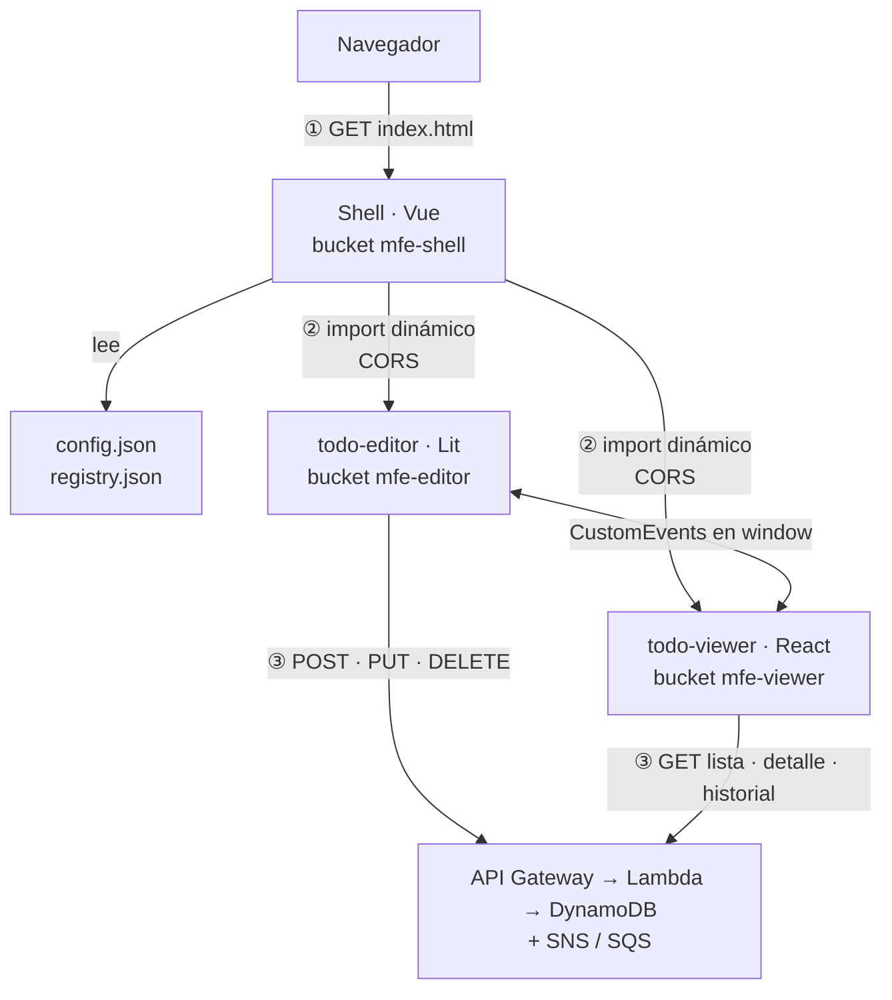
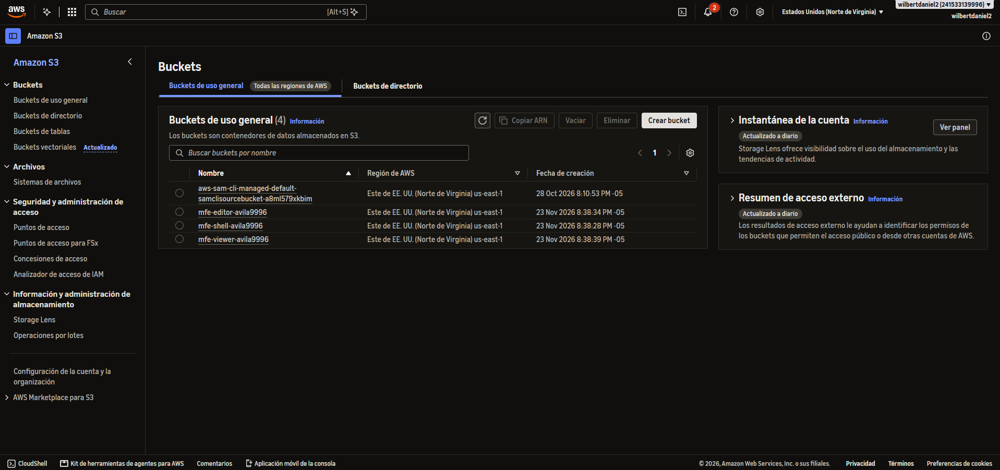

# Shell + Microfrontends para una aplicación TODO

Actividad final de **Sistemas Distribuidos**: la cara visible de la API de TODOs (Parte 2, con SNS y SQS), construida con una **arquitectura de microfrontends**. Un Shell ligero carga en tiempo de ejecución dos microfrontends que se desarrollan, compilan y publican de forma independiente, cada uno en su propio bucket de S3.

**Nivel objetivo: Intermedio** — tres tecnologías distintas (Vue, Lit y React), cada pieza compilada en `dist/` y expuesta como Custom Element.

> **Modalidad individual.** La actividad está pensada para 3 personas y 3 cuentas de AWS. La desarrollé de forma individual con autorización del docente, usando **una sola cuenta con tres buckets diferentes** (ver `capturas/02-autorizacion-docente.png`).

## URLs públicas

| Pieza | URL |
|---|---|
| Shell (aplicación) | http://mfe-shell-avila9996.s3-website-us-east-1.amazonaws.com |
| MFE Editor | http://mfe-editor-avila9996.s3-website-us-east-1.amazonaws.com/todo-editor.js |
| MFE Viewer | http://mfe-viewer-avila9996.s3-website-us-east-1.amazonaws.com/todo-viewer.js |
| API REST (Parte 2) | https://t795u1kstj.execute-api.us-east-1.amazonaws.com/dev/todos |
| Video de la demo | [Ver en Google Drive](https://drive.google.com/file/d/1Oh_f3jsKdtNAZK7Ro6OK_410mfk2Wbsi/view?usp=drive_link) |

## Las tres piezas

| Carpeta | Pieza | Tecnología | Bucket | Operaciones de la API |
|---|---|---|---|---|
| [`shell/`](shell/) | Shell (anfitrión) | **Vue 3** | `mfe-shell-avila9996` | Ninguna |
| [`mfe-editor/`](mfe-editor/) | `<todo-editor>` (escritura) | **Lit** | `mfe-editor-avila9996` | POST, PUT, DELETE |
| [`mfe-viewer/`](mfe-viewer/) | `<todo-viewer>` (consulta) | **React 19** | `mfe-viewer-avila9996` | GET lista, GET detalle, GET historial |

Todas se compilan con **Vite**. Cada carpeta tiene su propio README con los detalles de integración y despliegue.

## Arquitectura



1. El navegador descarga el Shell desde su bucket.
2. El Shell lee `config.json` (URL de la API) y `registry.json` (URLs de los microfrontends) y los importa con `import()` dinámico desde **otros orígenes** (por eso los buckets de los MFE tienen CORS).
3. Cada microfrontend habla directamente con la API REST. Entre ellos solo se comunican con **eventos del navegador**.

## Contrato entre las piezas

- **Etiquetas**: `<todo-editor>` y `<todo-viewer>` (Custom Elements con Shadow DOM).
- **Único atributo de entrada**: `api-url` (URL base de `/todos`, sin barra final).
- **Publicación**: un módulo ES (`.js`) que, al importarse, registra su Custom Element.

| Evento (en `window`) | Emite | Escucha | `detail` |
|---|---|---|---|
| `todo:created` | todo-editor | todo-viewer | TODO creado |
| `todo:updated` | todo-editor | todo-viewer | TODO actualizado |
| `todo:deleted` | todo-editor | todo-viewer | `{ id }` |
| `todo:selected` | todo-viewer | todo-editor | `{ id }` |

Ningún microfrontend importa código de otro. Los listeners se quitan al desmontar la etiqueta, y el texto de la API se pinta siempre como texto (nunca como HTML) para evitar XSS.

## Infraestructura (`infra/`)

| Archivo | Para qué |
|---|---|
| `policy-*.json` | Política de bucket con lectura pública (`s3:GetObject`) |
| `cors.json` | CORS de los buckets de los MFE, restringido al origen del Shell y a `localhost:5173` |

Creación de los buckets (desde la raíz del proyecto, en Git Bash):

```bash
SUF=avila9996
for p in shell editor viewer; do
  B="mfe-$p-$SUF"
  aws s3api create-bucket --bucket "$B" --region us-east-1
  aws s3api put-public-access-block --bucket "$B" \
    --public-access-block-configuration "BlockPublicAcls=false,IgnorePublicAcls=false,BlockPublicPolicy=false,RestrictPublicBuckets=false"
  aws s3 website "s3://$B/" --index-document index.html
  aws s3api put-bucket-policy --bucket "$B" --policy "file://infra/policy-$p.json"
done
for p in editor viewer; do
  aws s3api put-bucket-cors --bucket "mfe-$p-$SUF" --cors-configuration file://infra/cors.json
done
```

## Evidencias

| Prueba | Captura |
|---|---|
| Los tres buckets con el ID de cuenta visible |  |
| Autorización del docente para trabajo individual |  |
| DevTools → Network con los tres orígenes |  |
| Resiliencia: Editor bloqueado, Viewer funcionando |  |
| Flujo completo |  |

## Autor

Wilbert Daniel Avila Figueroa — Sistemas Distribuidos
